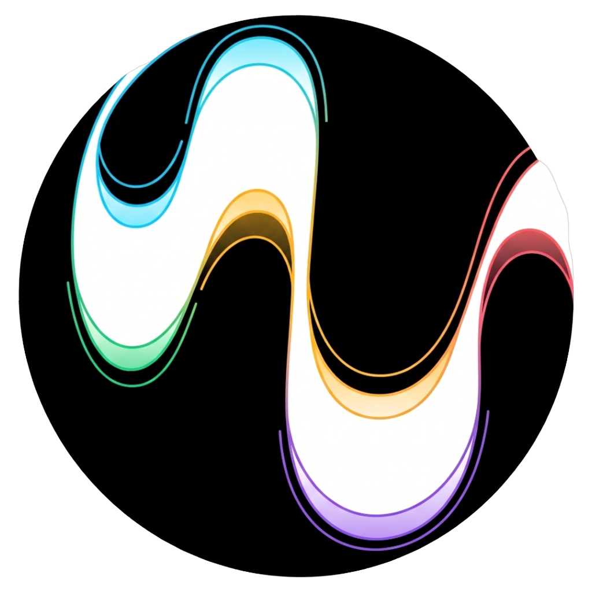

<div align="center">
  
  <h1>Heaviside DSP</h1>
  <p><strong>Standalone Real-Time Parametric &amp; Dynamic Equalizer, Dual-Bus Crossover Matrix, ASRC Multi-Device Sync, Intelligent Auto-Gain, Master Peak Limiter, 192 kHz DSP Engine, 60+ FPS Multi-Resolution FFT Spectrum Analyzer &amp; OpenGL Oscilloscope for Windows</strong></p>
  <p><em>System-wide studio audio processing and acoustic analysis — no DAW or plugin host required.</em></p>

  <p>
    
    
    
    
    
    
    
    
    
  </p>
</div>

---

## Overview

**Heaviside DSP** is a standalone, GPU-accelerated Windows audio processor and real-time acoustic analyzer built for mastering engineers, sound system tuners, and audiophiles.

It captures system audio (or live hardware inputs via Dual-Input routing), processes it through a vectorized **192 kHz** 64-bit/32-bit floating-point biquad DSP engine, splits or sums signals across a **Dual-Bus Linkwitz-Riley Crossover Matrix**, synchronizes independent soundcards via **Adaptive Sample Rate Conversion (ASRC)**, protects speakers with a **Master Peak Limiter**, and renders everything at **60+ FPS** inside a full-bleed **Apple Liquid Glass** OpenGL interface.

---

## Key Features

### 1. 60+ FPS Hop-Paced Multi-Resolution FFT & OpenGL Engine
- **Autonomous ~90 Hz FIFO Hop-Worker:** Decouples FFT spectral computation from soundcard buffer sizes (`64` to `2048` frames), eliminating decay starvation and artificial drops.
- **Hardware-Accelerated OpenGL Rendering:** Full GPU acceleration (`pyqtgraph` + `PyOpenGL`) delivering smooth 60+ FPS rendering across high-refresh-rate displays.
- **DWM VSync Decoupling:** Uses `QSurfaceFormat.setSwapInterval(0)` and 64-bit `wglSwapIntervalEXT(0)` to prevent Windows Desktop Window Manager from halving framerates to 30 FPS.
- **Triple-Stream Real-Time Spectrum:**
  - `Input (Pre-EQ)`: Unprocessed incoming signal trace.
  - `Output 1 (Bus A)`: Cyan spectral trace with custom fill showing post-EQ Bus A.
  - `Output 2 (Bus B)`: Emerald green spectral trace showing post-EQ Bus B.
- **Cubic Spline Smoothing & Natural Sub-10 Hz Roll-Off:** High-fidelity spline interpolation (`scipy.interpolate.make_interp_spline`) with elastic-band pinning at 10 Hz and Nyquist.
- **Zero-CPU Idle Optimization:** Suspends FFT computation and repaints during silence, dropping CPU usage to near 0%.

### 2. Studio Parametric & Dynamic EQ Engine
- **Vectorized Biquad SOS DSP:** Pure NumPy/SciPy Second-Order Sections (`Audio EQ Cookbook` topologies) preserving internal filter state (`zi`) across parameter changes for zero-click real-time modulation.
- **High-Resolution Sample Rates:** Native processing at `44.1 kHz`, `48 kHz`, `88.2 kHz`, `96 kHz`, `176.4 kHz`, and `192 kHz` with dynamic Nyquist axis auto-scaling up to $96\text{ kHz}$ and constant ~10.6 ms block latency scaling.
- **7 Filter Shapes:** `Bell`, `Low Shelf`, `High Shelf`, `Low Cut` (`12`–`48 dB/oct`), `High Cut` (`12`–`48 dB/oct`), `Notch`, and `Band Pass`.
- **Per-Band Channel Modes:** `Stereo (LR)`, `Left (L)`, `Right (R)`, `Mid (M)`, and `Side (S)` ($M = 0.5(L+R)$, $S = 0.5(L-R)$).
- **Per-Band Dynamic EQ:** Independent **Threshold** (`-70` to `0 dBFS`), **Dynamic Range** (`-30` to `+30 dB`), **Attack** (`0.5`–`500 ms`), and **Release** (`5`–`2000 ms`) with live dynamic excursion fill.
- **Ghost Preview Curve & Floating HUD:** Hover to preview a band and double-click to instantiate it; sculpt parameters with the Liquid Glass floating HUD and attached node callout.

### 3. Digital Crossover Matrix & High-Res PNG Exporter
- **Linkwitz-Riley Topologies:** Selectable `12 dB/oct` (2nd order), `24 dB/oct` (4th order), and `48 dB/oct` (8th order) slopes for flat acoustic summation at the crossover frequency.
- **Interactive Graph Cutoff:** Drag the vertical crossover marker directly on the EQ canvas with live Hz readout and magnetic snapping.
- **Dual-Bus Split (`Bus A` / `Bus B`):** Route Low-Pass to Subwoofers and High-Pass to Tops/Satellites (or vice versa), with independent **$180^\circ$ Phase Inversion** and output trim per bus.
- **High-Resolution PNG Exporter (`📸 Exportar PNG`):** Generates clean `1920x1080` crossover response snapshots with frequency grids, dB scales, and metadata watermarks.

### 4. Dual-Bus Routing, Dual-Input & ASRC Clock Sync (`audio_sync.py`)
- **Adaptive Resampling Ring Buffer (ASRC):** 32-tap Kaiser-windowed polyphase sinc interpolator (`2048` phases) with a proportional control loop that locks two independent audio hardware clocks (e.g., separate USB DACs, Bluetooth devices, or virtual cables) together without pops, drops, or audible pitch drift (< 5 cents).
- **Dual-Input Architecture (`Input 1` + `Input 2` Aux / Mic):** Independent secondary PortAudio stream with multi-tier latency fallback, real-time sample-rate conversion, simultaneous FFT/RTA monitoring, and selectable routing to Bus A / Bus B.
- **Acoustic Latency Auto-Compensation (`StereoDelayLine` & `⚡ Auto Sync`):** Sample-accurate stereo delay lines (up to $250\text{ ms}$) with one-click driver latency detection to phase-align physical speakers.

### 5. Intelligent Auto-Gain (`AutoGain`)
- **Dual-Bus Loudness Balancing:** Compares Pre-EQ input energy against Post-EQ Bus A and Bus B output energy in real time.
- **Perceptual Weighting:** Hybrid RMS and ITU-R BS.1770-style weighting for accurate perceived loudness matching.
- **Slew-Rate Limiting:** Smooth gain transitions prevent pumping or zipper noise, controlled from a dedicated Liquid Glass top-bar pill (`±X.X dB` readout, `Calibrar`, and instant bypass).

### 6. Master Peak Limiter & `MiniScopeGL` Oscilloscope
- **Dual-Bus Peak Limiter:** Vectorized envelope follower (`Ceiling`, `Threshold`, `Attack`, `Release`) protecting both Bus A and Bus B from digital clipping.
- **Live Gain Reduction (GR) Envelope:** Real-time purple/magenta gain reduction trace rendered directly over the oscilloscope waveform.
- **`MiniScopeGL` Hardware Capsule:** Native `QOpenGLWidget` mini oscilloscope in the top bar with adaptive luminous purple glow when limiting is active.
- **Expanded Analysis Panel:** Left (cyan) and Right (gold) waveforms with `1s`, `5s`, and `10s` history windows and smooth `+18 dBFS` auto-headroom.

### 7. Liquid Glass UI, Custom SVG Icons & Guided Help Tour
- **100% Full-Bleed Canvas:** Zero-margin dark studio aesthetic (`#0D0F14`) with shared 60 FPS GPU-cached Gaussian blur menus and custom vector SVG iconography (`dynamic_eq_svg_icons/`).
- **Dual Right dB Scales:** Signal level scale (`0` to `-120 dBFS`) paired with an EQ Gain scale (`±12 dB` / `±30 dB` toggleable badge) and a natural $-\infty$ bottom vignette.
- **Interactive Help Tour (`help_tour.py`):** Built-in spotlight overlay (`HelpSpotlightOverlay`) that guides you step-by-step through every control.
- **UAC-Safe Storage:** Automatically stores `config.json` and `presets/` locally in portable/dev mode, or in `%APPDATA%\Heaviside_DSP\` when installed in `C:\Program Files`.

---

## Keyboard Shortcuts & Mouse Gestures

| Action | Control / Gesture |
| :--- | :--- |
| **Add EQ Band** | Double-click canvas or double-click ghost preview curve |
| **Delete Selected Band** | `Delete` key, `✕` in HUD, or `✕` in node callout |
| **Adjust Frequency & Gain** | Click and drag any band node on the graph |
| **Adjust Band Q** | Mouse wheel over node or drag `Q` knob |
| **Fine Adjustment** | Hold `Shift` while dragging any knob, slider, or cutoff line |
| **Reset Knob to Default** | Double-click any knob |
| **Adjust Dynamic Range** | Right-click + drag on `GAIN` knob, or drag the outer radial handle tab |
| **Toggle Dynamic EQ Mode** | Click `⚡ DYN` in HUD, right-click band node, or toggle in callout |
| **Solo Active Band** | Click `🎧 Solo` in HUD or callout |
| **Channel Mode (`LR / L / R / M / S`)** | Dropdown in HUD |
| **Output Routing (`Out A / Out B / A+B`)** | Dropdown in HUD |
| **Adjust Crossover Frequency** | Click and drag the vertical crossover cutoff marker line |
| **Export Crossover Response** | Click `📸 Exportar PNG` inside the `XOVER` menu |
| **Toggle / Calibrate Auto-Gain** | Click `AUTO-GAIN` pill in top bar / `Calibrar` in popup |
| **Auto-Sync Outputs Latency** | Click `⚡ Auto Sync` in Audio I/O menu |
| **Toggle EQ Range (`±12` / `±30 dB`)** | Click the `+12 dB` / `+30 dB` badge in the top-right scale column |
| **Toggle Oscilloscope** | Click the mini-scope canvas or `▾` button |
| **Fullscreen / Exit** | `F11` (or `⛶`) / `Escape` |
| **Context Menu** | Right-click on background or band nodes |

---

## Audio Routing Tip (System-Wide Windows EQ)

To equalize all Windows system audio without a DAW:
1. Install a virtual audio device (such as **VB-Audio Virtual Cable**).
2. Set your Windows Default Output Device to **CABLE Input (VB-Audio Virtual Cable)**.
3. In **Heaviside DSP**, open **🎧 Audio I/O** and select:
   - **Input 1:** `[MME/WASAPI] CABLE Output (VB-Audio Virtual Cable)`
   - **Output A:** Your primary physical speakers or headphones (`Bus A`).
   - **Output B (Optional):** A secondary soundcard, subwoofer interface, or headphones (`Bus B`).
4. Click `⚡ Auto Sync` to align output latency across devices (ASRC automatically handles clock drift).
5. Click **🔇 Muted (Activar)** to switch to **🔊 Audio ON**.

---

## Installation & Running from Source

### Option A: Windows Installer (Recommended for Users)
Download **`Heaviside DSP Setup.exe`** from the [Releases](https://github.com/eOlmosDJ/HeavisideDSP/releases) page and run the bilingual (English / Spanish) installer.

### Option B: Run from Source (Developers)

**Prerequisites:** Windows 10 or Windows 11 (64-bit) and Python `3.10`–`3.14`.

```bash
# 1. Clone the repository
git clone https://github.com/eOlmosDJ/HeavisideDSP.git
cd HeavisideDSP

# 2. Create and activate a virtual environment
python -m venv venv
venv\Scripts\activate

# 3. Install dependencies
pip install -r requirements.txt

# 4. Launch Heaviside DSP
python main.py
```

---

## Building Standalone Executable & Installer

### One-Click Build (`build.bat`)
```cmd
build.bat
```
This script validates dependencies, builds `dist\Heaviside DSP.exe` via PyInstaller, and—if [Inno Setup 6 or 7](https://jrsoftware.org/isdl.php) (`ISCC.exe`) is installed—compiles `Heaviside DSP Setup.exe`.

### Manual Compilation
```bash
# Standalone executable (dist/Heaviside DSP.exe)
pyinstaller "Heaviside DSP.spec" --noconfirm

# Windows Installer (Heaviside DSP Setup.exe)
"C:\Program Files\Inno Setup 7\ISCC.exe" setup.iss
```

---

## Project Structure

```text
Analyzer/
├── assets/
│   ├── icon.ico                  # Multi-resolution Windows application icon
│   └── logo.png                  # Heaviside DSP circular waveform emblem
├── docs/
│   └── AGENT_SPEC.md             # Technical architecture & DSP/UI engineering rules
├── dynamic_eq_svg_icons/         # Custom vector SVG icons for HUD, filters & controls
├── presets/                      # Factory & user EQ/crossover presets
├── audio_sync.py                 # 32-tap Kaiser polyphase ASRC dual-clock ring buffer
├── eq_dsp.py                     # Vectorized biquad EQ, Dynamic EQ, Crossover, AutoGain & Limiter
├── eq_ui.py                      # Liquid Glass UI, MiniScopeGL, HUD, Crossover line & Callout
├── fft_analyzer.py               # 60+ FPS hop-paced 3-stream FFT spectrum analyzer engine
├── help_tour.py                  # Interactive spotlight help tour overlay
├── main.py                       # Application orchestrator, audio router, delay lines & OpenGL window
├── build.bat                     # Automated PyInstaller + Inno Setup build script
├── build_installer.iss           # Inno Setup script (Instalador/Heaviside DSP Setup.exe)
├── setup.iss                     # Root Inno Setup script (Heaviside DSP Setup.exe)
├── setup.ino                     # Inno Setup script alias
├── Heaviside DSP.spec            # PyInstaller build specification
├── version_info.txt              # Windows PE version metadata (v1.2.0)
├── config.json                   # Saved preferences, band states, delays & crossover settings
├── requirements.txt              # Python dependencies
├── LICENSE                       # MIT License
└── README.md                     # Project documentation
```

---

## License

This project is licensed under the **MIT License** — see the [LICENSE](LICENSE) file for details.
