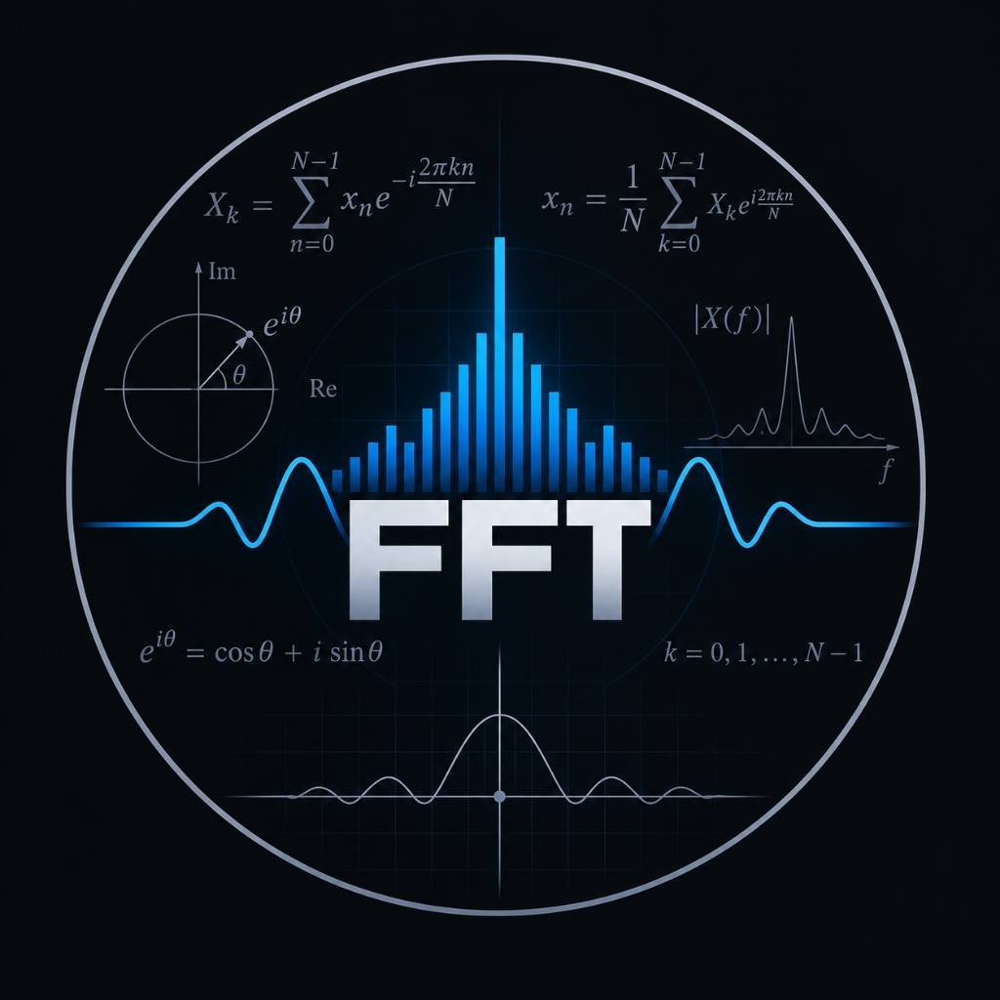
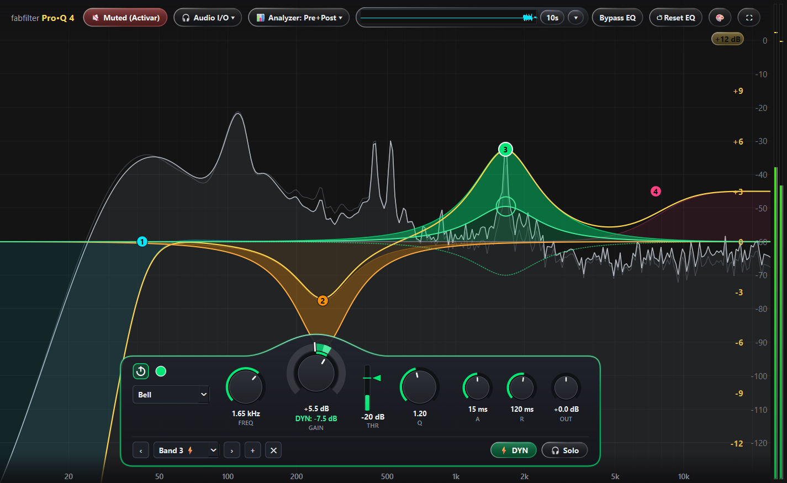
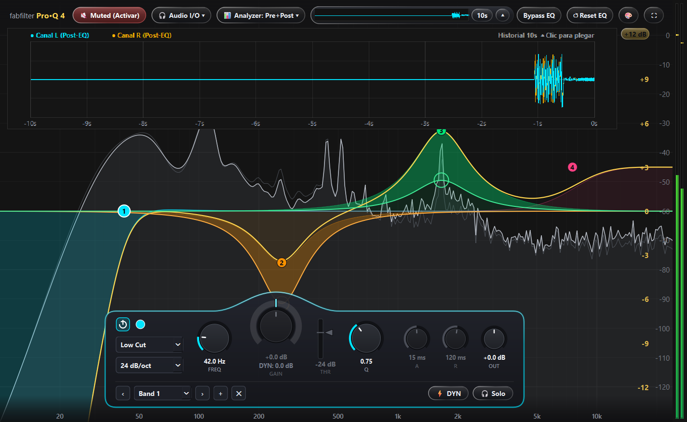

<div align="center">
  
  <h1>BDJ-FFT-EQ</h1>
  <p><strong>Real-Time Parametric & Dynamic Equalizer, FFT Spectrum Analyzer & Oscilloscope for Windows</strong></p>
</div>


A professional, studio-grade standalone Parametric & Dynamic Equalizer with integrated real-time system audio routing, high-resolution FFT spectrum analyzer, and scroll-blitted oscilloscope.

Process, sculpt, and equalize Windows system audio in real time with ultra-low latency—**no DAW or plugin host required**.

---

## Screenshots

### Main Interface & Floating Band HUD


### Expanded 10-Second Scroll-Blitted Oscilloscope


---

## Key Features

### 1. Studio-Grade Parametric & Dynamic EQ Engine
- **Vectorized Biquad DSP:** Pure NumPy implementation of Second-Order Sections (SOS) using Audio EQ Cookbook (Robert Bristow-Johnson) filter topologies evaluated directly with complex phasors ($z^{-1}, z^{-2}$).
- **7 Filter Shapes:**
  - `Bell` (parametric peak)
  - `Low Shelf` & `High Shelf`
  - `Low Cut` (High Pass) & `High Cut` (Low Pass) with selectable slopes: `12 dB/oct`, `24 dB/oct`, `36 dB/oct`, `48 dB/oct`
  - `Notch` (band reject) & `Band Pass`
- **Full Dynamic EQ per Band:**
  - Independent **Threshold** (`THR`, $-70$ to $0\text{ dBFS}$) with live signal meter.
  - **Dynamic Range** ($-30$ to $+30\text{ dB}$) relative to static gain.
  - Adjustable **Attack** ($0.5$ to $500\text{ ms}$) and **Release** ($5$ to $2000\text{ ms}$) ballistics.
  - Real-time animated dynamic excursion curve and shaded area fill (`FillBetweenItem`) showing instantaneous compression or expansion.
- **Per-Band Controls:** On/Off toggle, Solo listening mode (`🎧 Solo`), custom band color swatches, and direct node dragging on the canvas.
- **Master Controls:** Master Output Gain ($-24$ to $+24\text{ dB}$), global **Bypass EQ**, and one-click **Reset EQ**.

### 2. Full-Bleed Studio UI & Apple Liquid Glass Aesthetics
- **100% Full-Bleed Canvas:** Zero margins (`0px`) on left, top, bottom, and right. FFT and EQ curves seamlessly touch $x = 0$ on the left and the stereo meter on the right.
- **Unified Dual Right dB Scales:**
  - **Far-Right Column (`#787C85`):** Signal level scale ($0, -10, -20 \dots -120\text{ dBFS}$).
  - **Inner-Adjacent Column (`#E0B84C` bold):** EQ Gain scale aligned with horizontal grid lines.
  - **Scale Toggle Badge:** Interactive Apple Liquid Glass badge in the scale header toggling the visual gain range between $\pm 12\text{ dB}$ and $\pm 30\text{ dB}$.
- **Natural $-\infty$ Bottom Fade:** Canvas extends down to $-132\text{ dB}$ with a $45\text{ px}$ dark gradient vignette so Low Cut / High Cut slopes and FFT energy smoothly dissolve into the bottom edge without abrupt flat shelves.
- **Floating Apple Liquid Glass Top Bar:** Translucent vitreous pills with $1.2\text{ px}$ diagonal specular borders floating over the canvas, shielded by a top gradient mask.
- **Ergonomic Floating HUD:** Large $88\text{ px}$ `GAIN` knob centered inside the top convex arch ("joroba"), wide $10\text{ px}$ outer Dynamic Range ring with radial handle tab, and clean bottom navigation bar.

### 3. Ultra-Low CPU Oscilloscope (Scroll-Blitting)
- **Compact View:** Sleek Liquid Glass capsule in the top bar displaying the live waveform.
- **Expanded View:** $164\text{ px}$ deep analysis panel showing Left (cyan) and Right (gold) post-EQ channels with second grid markers.
- **Hardware Scroll-Blitting (`QPixmap.scroll`):** Instead of redrawing 10 seconds of waveform each frame, the offscreen canvas scrolls left by $dx$ pixels and only paints the newest vertical slice ($< 1\%$ CPU utilization).
- **Time Window Toggle:** Quick toggle between `5s` and `10s` history.

### 4. High-Resolution FFT Spectrum Analyzer
- **Decoupled Ring Buffer:** Configurable FFT resolution from $512$ to $16,384$ samples (default $4096$) without affecting audio I/O latency.
- **Pre-EQ & Post-EQ Visualization:** Simultaneous tracking of raw incoming audio (faint ghost curve) and processed output spectrum.
- **Hardware-Accelerated 2D Rendering:** Hardware GPU acceleration (`OpenGL`) maintaining fluid 60 FPS.
- **Zero-CPU Idle Optimization:** Dynamic dirty-flag architecture stops computing FFT, cubic splines, and redraws when the audio signal is at rest in silence.
- **Studio Color Presets:** Neutral Pure Studio Gray (`#141414`), Studio Carbon (`#1E1E1E`), Absolute Black (`#080808`), Deep Studio Blue (`#0D1017`), and Analog Amber (`#140C02`).

### 5. Robust Audio I/O & Safety
- **High-Priority PortAudio Stream:** Built with `sounddevice` running a non-blocking C callback with $512$-sample audio blocks (~$10.6\text{ ms}$ at $48\text{ kHz}$).
- **Feedback Loop Protection:** Application always boots in **Muted** state to prevent accidental feedback loops.
- **State Persistence:** Settings, audio devices, sample rates ($44.1\text{ kHz}$ to $96\text{ kHz}$), themes, and all band parameters are auto-saved to `config.json`.

---

## Keyboard Shortcuts & Mouse Gestures

| Action | Control / Gesture |
| :--- | :--- |
| **Add EQ Band** | Double-click canvas or click `+` in HUD |
| **Delete Selected Band** | `Delete` key or `✕` in HUD |
| **Adjust Frequency & Gain** | Click and drag any band node on the graph |
| **Adjust Band Q** | Mouse wheel over node or drag `Q` knob |
| **Fine Adjustment** | Hold `Shift` while dragging any knob or slider |
| **Reset Knob to Default** | Double-click any knob |
| **Adjust Dynamic Range** | Right-click + drag anywhere on `GAIN` knob, or drag the outer radial handle tab |
| **Toggle Dynamic EQ Mode** | Click `⚡ DYN` in HUD or right-click band node |
| **Solo Active Band** | Click `🎧 Solo` in HUD or right-click band node |
| **Toggle EQ Range ($\pm 12$ / $\pm 30$ dB)** | Click the `+12 dB` / `+30 dB` badge in the top-right scale column |
| **Toggle Oscilloscope** | Click the mini-scope canvas or `▾` button |
| **Fullscreen** | `F11` (or click `⛶`) |
| **Exit Fullscreen / Collapse Scope** | `Escape` |
| **Context Menu** | Right-click on background or band nodes |

---

## Project Structure

```
Analyzer/
├── assets/
│   ├── icon.ico                  # Application multi-resolution Windows icon
│   ├── logo.png                  # Application emblem and visual badge
│   ├── proq4_main_hud.png        # Screenshot: Main interface & HUD
│   └── proq4_scope_expanded.png  # Screenshot: Expanded oscilloscope
├── docs/
│   └── AGENT_SPEC.md             # Architecture and technical design specification
├── build.bat                     # Single-click PyInstaller build script
├── config.json                   # Auto-saved user preferences and band states
├── eq_dsp.py                     # Vectorized DSP biquad filter & dynamic EQ engine
├── eq_ui.py                      # BDJ-FFT-EQ overlay, Liquid Glass widgets & floating HUD
├── fft_analyzer.py               # Rolling ring buffer FFT spectrum analyzer
├── main.py                       # Main application window & PortAudio stream manager
├── requirements.txt              # Python package dependencies
└── README.md                     # Project documentation
```

---

## Installation & Running

### Prerequisites
- **Operating System:** Windows 10 or Windows 11 (64-bit)
- **Python:** Python 3.10, 3.11, or 3.12

### Setup
1. Clone the repository:
   ```bash
   git clone https://github.com/eOlmosDJ/StandAlone-FFT-visualizer-and-EQ.git
   cd StandAlone-FFT-visualizer-and-EQ
   ```

2. Create and activate a virtual environment (recommended):
   ```bash
   python -m venv venv
   venv\Scripts\activate
   ```

3. Install required dependencies:
   ```bash
   pip install -r requirements.txt
   ```

4. Launch the application:
   ```bash
   python main.py
   ```

---

## Building Standalone Executable (.exe)

To build a standalone, single-file Windows executable (`dist/FIRST RELEASE.exe`):

```cmd
build.bat
```

Or run PyInstaller directly:
```bash
pyinstaller --noconsole --onefile --icon "assets/icon.ico" --add-data "assets;assets" --name "FIRST RELEASE" main.py
```

The resulting executable will be created in the `dist/` directory.

---

## Audio Routing Tip (Virtual Audio Cable)

To equalize your entire Windows system audio:
1. Install a virtual audio device (such as **VB-Audio Virtual Cable**).
2. Set Windows Default Output Device to **CABLE Input (VB-Audio Virtual Cable)**.
3. In this application, click **🎧 Audio I/O** and select:
   - **Input Device:** `[MME/WASAPI] CABLE Output (VB-Audio Virtual Cable)`
   - **Output Device:** Your physical speakers or headphones.
4. Click **🔇 Muted (Activar)** to enable **🔊 Audio ON**.

---

## License

This project is licensed under the MIT License - see the LICENSE file for details.
